<p align="center">
  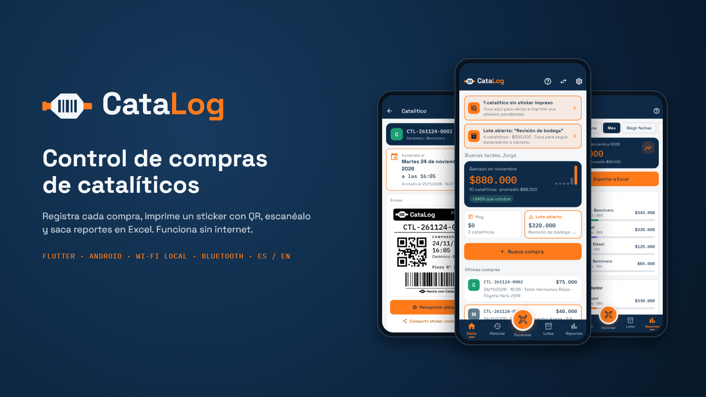
</p>

<p align="center">
  
  
  
  
  
  
  
  
</p>

**CataLog** es una app para Android que lleva el control de las compras de catalíticos de un negocio familiar en Arica, Chile. Cada compra queda registrada con su fecha, vendedor, lugar, precio y tipo. La app le imprime al catalítico un sticker con QR y código de barras, lo lee después con la cámara, permite cuadrar inventario por Wi-Fi local con el supervisor y arma los reportes en Excel. Funciona en terreno sin internet y los datos se guardan solo en el teléfono.

<p align="center">
  <a href="#funciones">Funciones</a> ·
  <a href="#pantallas">Pantallas</a> ·
  <a href="#el-sticker">Sticker</a> ·
  <a href="#cómo-funciona">Cómo funciona</a> ·
  <a href="#tecnologías">Tecnologías</a> ·
  <a href="#arquitectura">Arquitectura</a> ·
  <a href="#pruebas">Pruebas</a> ·
  <a href="#compilar">Compilar</a>
</p>

---

## El problema

El negocio compra catalíticos casi todos los días, pero no llevaba registro: no quedaba anotado a quién se le compró, cuándo, dónde ni cuánto se pagó. Cuando se juntaban muchas piezas no había forma de saber cuánto se había gastado ni de dónde venía cada una.

CataLog anota cada compra en el momento y le asigna un código único. Ese código va impreso en un sticker que se pega en el catalítico, y más adelante basta con escanearlo para ver toda su ficha o verificarlo en bodega.

## Funciones

| | |
|---|---|
| **Registro rápido en terreno** | Fecha y hora de compra, vendedor y vehículo con **chips rápidos de 1 toque** según los más frecuentes, lugar con GPS, precio en pesos chilenos, motor (bencinero o diésel), material (cerámico, metálico o DPF), **estado de llenado de la cerámica** (*Entero 100% · 3/4 · Medio · Fundido/Partido*), código grabado de fábrica (con **referencia automática** de lo pagado antes) y **foto ligera (~80 KB)**. |
| **Fotos ultra ligeras** | Por defecto comprime cada captura a ~80 KB sin perder nitidez del código grabado (selector *Ligera / Normal / Alta* en Ajustes y botón **Optimizar fotos guardadas** para comprimir fotos antiguas). |
| **La fecha es lo principal** | Se llena sola, es obligatoria, se puede corregir y nunca puede ser futura. El código usa la fecha de compra (no la del registro) y la ficha muestra si alguien la corrigió y cuándo. |
| **Código único** | `PREFIJO-AAMMDD-NNNN`, por ejemplo `CTL-261122-0002`: el prefijo del teléfono, el día de compra y el número de pieza de ese día. El número se asigna dentro de una transacción y no se repite. |
| **Stickers térmicos + Etiqueta QR de Saco** | Stickers individuales con QR y Code 128 por Bluetooth en 58 u 80 mm (sin precios) + **Etiqueta Maestra QR del Saco / Caja** al cerrar un lote (resumen de piezas, desglose `Cerámico / Metálico / DPF` y QR). Si una compra aún tiene `0 impresiones`, destaca con **borde naranja y aviso `No se le ha sacado el sticker`**. |
| **Lotes sin repetir piezas + Ganancia neta** | Escaneo continuo de stickers con **bloqueo anti-duplicados tanto dentro del mismo lote como entre lotes distintos** (indica en qué lote anterior ya fue guardada la pieza). Destaca lotes abiertos y calcula la **utilidad neta** (`Venta − Costo`). |
| **Revisión de Supervisor v1.7** | Módulo ejecutivo rediseñado con **anillo de avance en vivo**, compras **agrupadas por fecha**, miniatura de foto, botón de **Observación / Discrepancia** de 1 toque (destacado en rojo), guardado como **Lote de Supervisor** (para que ningún catalítico revisado vuelva a repetirse en otro lote), etiqueta QR del saco y exportación a Excel. |
| **Sincronización filtrada por fechas (WhatsApp y Wi-Fi)** | Al enviar compras por **WhatsApp / archivo (`.zip`)** o por **Wi-Fi local con QR**, eliges el período exacto (**Hoy, Últimos 7 días, Este mes, Rango de fechas o Solo pendientes sin lote**) para no arrastrar todo el historial de catalíticos. |
| **Excel corporativo con Tablas Dinámicas** | Exporta libros `.xlsx` con el **logo oficial de CataLog incrustado**, cintillo de marca *"Generado por CataLog"*, tablas nativas filtrables (`ExcelTable`), filas de discrepancia/anulación en rojo y hoja **`Tabla Dinámica`** con `PivotTable`s reales listas para cruzar por vendedor, tipo, estado y llenado. |
| **Notificaciones Pop-up y periódicas** | Notificaciones emergentes (`Heads-Up`) con la **insignia grande de CataLog a color** y silueta del catalítico: avisan **apenas sales de la app** si quedó un sticker sin sacar o un lote abierto, **se repiten periódicamente en el día** (cada 30 min, 1 h, 2 h o 4 h) mientras sigan pendientes, y avisan al escanear o guardar respaldos. |
| **Respaldo inteligente sin basura** | Respaldos `.zip` en `Descargas/Respaldo CataLog` con modo **Sobrescribir archivo único** (por defecto, siempre al día sin acumular copias repetidas) o **Expiración automática** (7 o 30 días), más el botón rojo **Ubicar respaldo** directo a Archivos. |
| **Nada se borra + Seguridad** | Las compras se anulan quedando registradas en el historial. Bloqueo opcional con huella analizada en pantalla (sin revelar montos) y confirmación biométrica antes de anular, borrar o reemplazar datos. |
| **Apariencia e idioma** | Modo claro, oscuro o automático, alto contraste, tres tamaños de letra, animaciones opcionales e idioma **Español / English** en vivo. |
| **Bienvenida, presentación y guía** | Bienvenida animada con armado del logo, carrusel ilustrado de primera vez y botón de ayuda (`?`) en cada pantalla que ilumina cada control paso a paso. |

## Pantallas

<table>
  <tr>
    <td align="center" width="25%">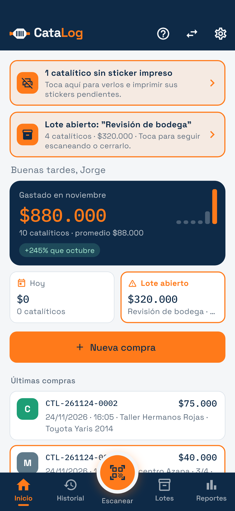<br><sub><b>Inicio</b><br>Avisos con borde, mes y compras</sub></td>
    <td align="center" width="25%"><br><sub><b>Nueva compra</b><br>Referencia de precio y chips rápidos</sub></td>
    <td align="center" width="25%">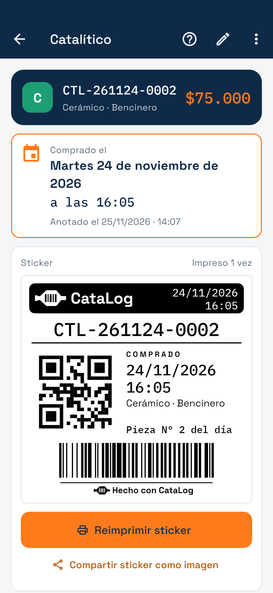<br><sub><b>Ficha</b><br>Fecha de compra y sticker</sub></td>
    <td align="center" width="25%">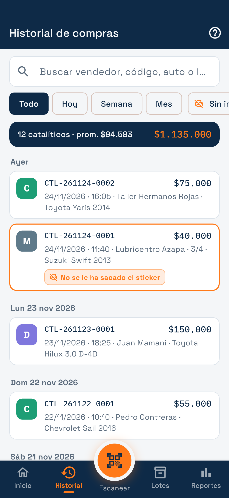<br><sub><b>Historial</b><br>Filtro Sin imprimir y búsqueda</sub></td>
  </tr>
  <tr>
    <td align="center"><br><sub><b>Reportes</b><br>Por tipo y por vendedor, con Excel</sub></td>
    <td align="center"><br><sub><b>Lotes</b><br>Utilidad neta y borde de lote abierto</sub></td>
    <td align="center">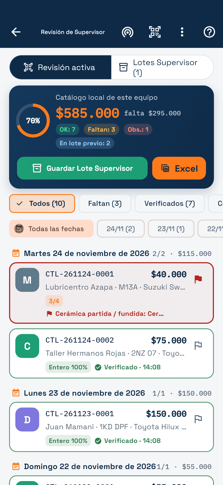<br><sub><b>Revisión de Supervisor</b><br>Verificación con escáner y Excel</sub></td>
    <td align="center">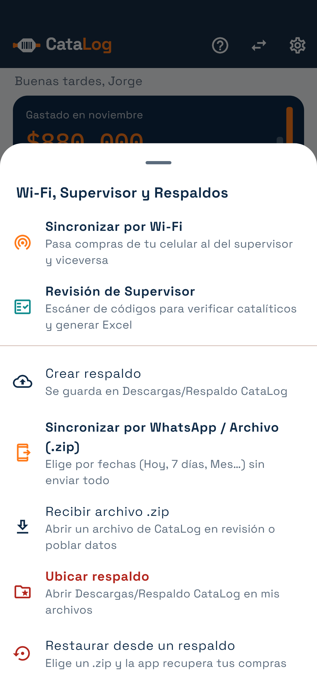<br><sub><b>Wi-Fi y Respaldos</b><br>Sincronización local y accesos</sub></td>
  </tr>
</table>

<sub>Las capturas usan datos de ejemplo (vendedores y autos inventados) y se generan con la propia app en <code>catalog_app/test/capturas_test.dart</code>.</sub>

### Bienvenida, bloqueo, temas e idioma

<table>
  <tr>
    <td align="center" width="25%"><br><sub><b>Bienvenida</b><br>Logo que se arma y saludo</sub></td>
    <td align="center" width="25%">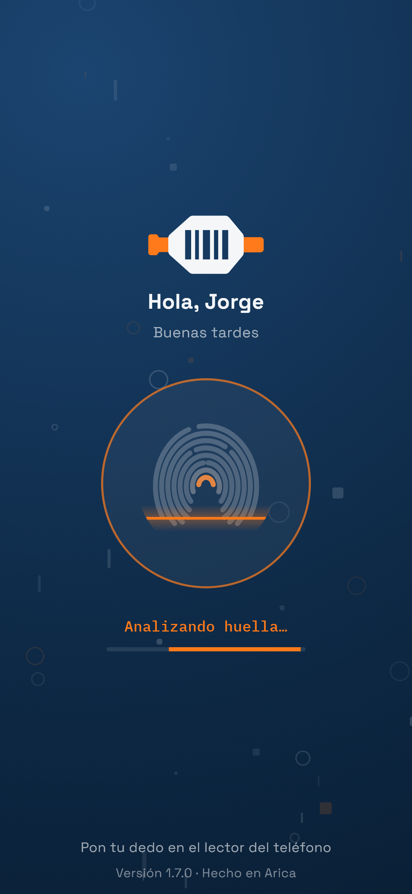<br><sub><b>Bloqueo</b><br>Análisis de huella sin mostrar montos</sub></td>
    <td align="center" width="25%">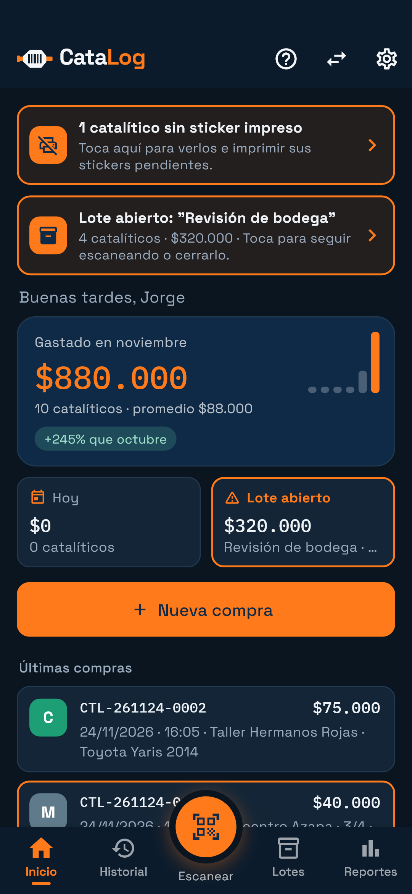<br><sub><b>Modo oscuro</b><br>Inicio en paleta oscura</sub></td>
    <td align="center" width="25%">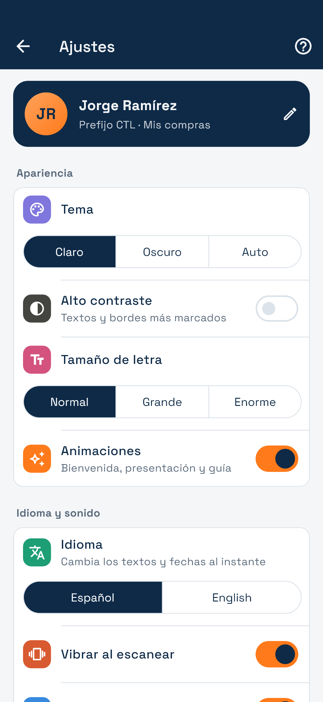<br><sub><b>Ajustes</b><br>Tema, fotos ligeras e idioma ES / EN</sub></td>
  </tr>
  <tr>
    <td align="center"><br><sub><b>Presentación</b><br>Ilustraciones animadas</sub></td>
    <td align="center"><br><sub><b>Antes de empezar</b><br>Nombre, prefijo y vista del código</sub></td>
    <td align="center">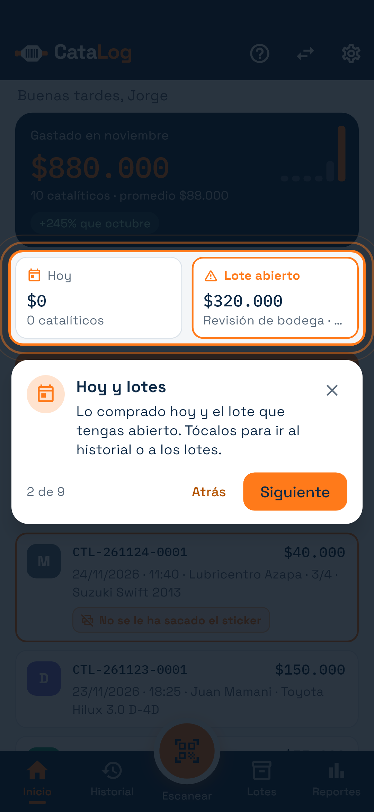<br><sub><b>Guía</b><br>Botón de ayuda en cada pantalla</sub></td>
    <td align="center">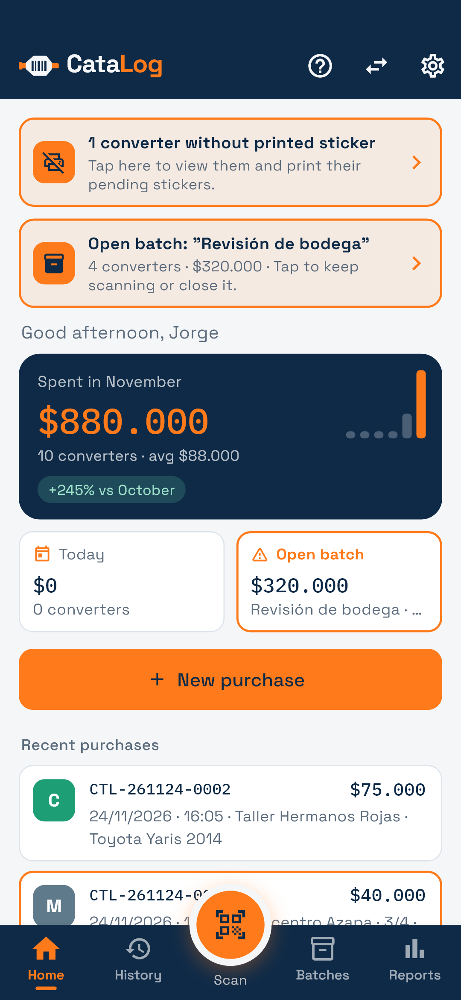<br><sub><b>English</b><br>Cambio de idioma en vivo</sub></td>
  </tr>
</table>

## El sticker

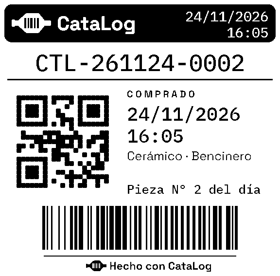

El sticker se dibuja con `dart:ui` al ancho exacto de la impresora (384 puntos para 58 mm y 576 para 80 mm). Después se pasa a blanco y negro y se envía como imagen ESC/POS (`GS v 0`). Así lo impreso sale igual a la vista previa, con las fuentes de la marca y los acentos, en cualquier impresora térmica.

- **QR** con el código con guiones: `CTL-261122-0002`.
- **Code 128** sin guiones: `CTL2611220002`. El codificador está escrito a mano y probado con un lector externo (zbar).
- La fecha y hora de compra, el tipo y el número de pieza del día.
- **El precio no se imprime:** solo lo ve quien escanea el sticker con CataLog.

**Impresoras compatibles:** ESC/POS por Bluetooth clásico (SPP), ESC/POS por Bluetooth LE y las mini impresoras de AliExpress con el protocolo de tipo "gato" (servicio `AE30`, paquetes `0x51 0x78`, CRC-8). Si ninguna conecta, el sticker se comparte como imagen.

<br clear="right">

## Cómo funciona

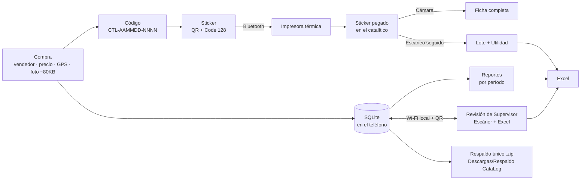

## Tecnologías

| Área | Tecnología | Uso |
|---|---|---|
| App | **Flutter 3.50 · Dart 3.14** | Android (API 24+, target 36). Interfaz con `material_ui` (Material 3). |
| Datos | **SQLite** (`sqflite`) | Base local con migraciones (`v3`); `sqflite_common_ffi` en las pruebas. |
| Sincronización | `dart:io` (`ServerSocket`, `Socket`, `RawDatagramSocket`) | Descubrimiento UDP y transferencia TCP directa entre celulares en la misma red Wi-Fi, emparejada con QR y PIN temporal. |
| Sticker | `dart:ui` · `qr` · Code 128 propio | Dibujo del sticker, QR y código de barras sin servicios externos. |
| Impresión | `print_bluetooth_thermal` · `universal_ble` | ESC/POS por SPP y por BLE, más el protocolo de tipo "gato", con comandos armados en `lib/printing/`. |
| Escáner | `mobile_scanner` (ML Kit incluido) | Lectura de QR y Code 128 sin internet en escáner, lotes, Wi-Fi y Revisión de Supervisor. |
| Ubicación y fotos | `geolocator` · `image_picker` · Kotlin (`Bitmap` + `ExifInterface`) | GPS sin conexión, captura ligera (~80 KB) y optimizador nativo de fotos guardadas. |
| Reportes | `excel_plus` · `share_plus` | Excel de reportes, lotes (con utilidad neta) y Revisión de Supervisor. |
| Notificaciones | Kotlin (`NotificationManager` + `AlarmManager`) | Pop-ups `IMPORTANCE_HIGH` con insignia a color, aviso al salir y repetición periódica en el día. |
| Respaldo | `archive` · `file_picker` · Kotlin (`MediaStore`) | `.zip` sobrescribible o con expiración automática por días en `Descargas/Respaldo CataLog`. |
| Seguridad | `local_auth` | Huella, rostro o PIN del teléfono. |

## Arquitectura

La app no usa frameworks pesados de estado: un `InheritedWidget` (`AppScope`) entrega la base, los repositorios y las preferencias del dispositivo, y un widget `Consulta` vuelve a leer la base cada vez que cambia algo.

```
catalog_app/lib/
├── main.dart            raíz: ciclo de vida (aviso al salir), bloqueo, respaldo diario
├── app_scope.dart       acceso a base, repositorios y preferencias desde cualquier pantalla
├── data/                SQLite, migraciones, compras, lotes, revisiones, GPS, fotos ligeras
├── domain/              código PREFIJO-AAMMDD-NNNN, formato CLP, períodos, tipos
├── features/            bienvenida, inicio, compra, ficha, lotes, reportes, supervisor, ajustes
├── sync/                autodescubrimiento UDP y transferencia TCP por Wi-Fi local con QR
├── printing/            sticker, Code 128, ESC/POS, raster 1 bit, protocolo "gato", Bluetooth
├── reports/             cálculos de reportes y exportación a Excel (período, lote y supervisor)
├── backup/              respaldo .zip (sobrescribible o con expiración) y copia diaria
├── system/              huella/PIN, notificaciones locales periódicas, canal nativo Android
└── widgets/             logo, animaciones, guía interactiva, escáner, chips de autocompletado
```

### Datos y privacidad

- Todo queda en el teléfono: no hay servidores externos, cuentas ni nube.
- El permiso de red se utiliza **exclusivamente en red Wi-Fi local** (`192.168.x.x` / `10.x.x.x`) cuando tú abres *Sincronizar por Wi-Fi* para conectar dos celulares con un PIN temporal de 6 dígitos.
- Cada teléfono tiene su propio prefijo (`CTL`, `CTT`…), así los códigos nunca chocan.
- Quien escanee un sticker con otra app solo ve el código, nunca el precio pagado.

## Pruebas

**93 pruebas automáticas** (`flutter test`). Cubren:

- Fecha de compra obligatoria, no futura, reflejada en el código y con auditoría de correcciones.
- Generador transaccional de códigos únicos por día.
- Referencia automática de precio por código de fábrica, autocompletado por frecuencia de uso y filtro `Sin imprimir`.
- Code 128, comandos ESC/POS, sticker a 58/80 mm y protocolo de impresoras tipo "gato".
- Exportación y lectura de Excel de reportes, lotes con utilidad neta y Revisión de Supervisor.
- Sincronización bidireccional TCP en red local con transferencia real de base y fotos.
- Respaldo `.zip`, modos de sobrescritura/expiración y estadísticas de fotos ligeras.
- Notificaciones locales al salir de la app y programación periódica durante el día.
- Diseño responsivo sin desbordes en teléfonos chicos con letra grande (ES y EN), normales y tablets.

```bash
cd catalog_app
flutter analyze
flutter test
# Capturas del README (datos de ejemplo), quedan en build/capturas/
flutter test test/capturas_test.dart --dart-define=CAPTURAS=true
```

## Compilar

Requisitos: Flutter 3.50, JDK 21 y Android SDK (plataforma 37, build-tools 36.1, NDK 28.2).

```bash
cd catalog_app
flutter pub get
flutter build apk --release   # necesita la llave de firma
flutter build apk --debug     # para probar sin la llave
```

La llave de firma (`llaves/`, `key.properties`) y los APK compilados (`apk/`) **no están en el repositorio**. Todas las versiones se firman con la misma llave, así que una versión nueva se instala encima de la anterior sin borrar las compras.

## Versiones

| Versión | Fecha | Cambios principales |
|---|---|---|
| **1.7.0** | 25-11-2026 | Estado de llenado de cerámica (*Entero 100% · 3/4 · Medio · Fundido/Partido*); sincronización WhatsApp/Wi-Fi **filtrada por fechas**; bloqueo de catalíticos repetidos **entre lotes distintos** (comprador y **Lotes de Supervisor**); rediseño de **Revisión de Supervisor** con anillo de avance, agrupación por fecha y botón de **Observación / Discrepancia** en rojo; **Etiqueta Maestra QR para Saco/Caja**; nuevo **Excel con logo oficial CataLog incrustado, tablas filtrables y Tablas Dinámicas (`PivotTable`)**. |
| 1.6.0 | 24-11-2026 | Fotos ligeras (~80 KB) y optimizador de fotos guardadas; notificaciones Pop-up con logo grande a color, aviso al salir de la app y recordatorios periódicos en el día; bordes y avisos para compras sin sticker y lotes abiertos; chips rápidos de Vendedor y Auto frecuente; módulo operativo **Revisión de Supervisor** (escáner + Excel, sin cambiar de sesión); **Sincronización por Wi-Fi local** (Comprador ⇄ Supervisor con QR); respaldos con sobrescritura de archivo único o expiración automática. |
| 1.5.1 | 24-11-2026 | Canal de notificaciones en `IMPORTANCE_HIGH` para alertas emergentes (`Heads-Up`). |
| 1.5.0 | 24-11-2026 | Referencia automática de precio por código de fábrica, utilidad neta (`Venta − Costo`) en lotes y su Excel, filtro `Sin imprimir` en Historial, notificaciones locales y tarjeta roja **Ubicar respaldo** directo en Archivos. |
| 1.4 | 23-11-2026 | Barra de pestañas fija con Escanear al centro, bloqueo con huella analizada, rediseño completo de pantallas, modo oscuro, alto contraste, tamaño de letra e idioma Español / English en vivo. |
| 1.3 | 23-11-2026 | Bienvenida animada, presentación en carrusel, guía interactiva con botón de ayuda y arranque en azul marino. |
| 1.2.1 | 23-11-2026 | Probada en el celular real. Arreglo del aviso al quitar un catalítico de un lote. |
| 1.2 | 23-11-2026 | Logo refinado, sticker nuevo, Excel rediseñado, carpeta `Respaldo CataLog`, huella para borrar y diseño responsivo. |
| 1.1 | 22-11-2026 | Envío de datos a otro celular, respaldo diario y bloqueo con huella o PIN. |
| 1.0 | 22-11-2026 | Registro, sticker, impresión Bluetooth, escáner, lotes, reportes en Excel y respaldo. |

## Marca

<picture>
  <source media="(prefers-color-scheme: dark)" srcset="marca/catalog-logo-oscuro.svg">
  
</picture>

| Color | Hex | Uso |
|---|---|---|
|  Azul marino | `#0E2A47` | Fondo de la marca, barras y textos |
|  Naranja escape | `#FF7A1A` | Acciones principales y tubos del logo |
|  Gris niebla | `#F4F6F8` | Fondos claros |
|  Acero | `#5B6B7C` | Textos secundarios |

Fuentes: **Space Grotesk** (textos) e **IBM Plex Mono** (códigos y montos). Los logos, íconos y propuestas anteriores están en [`marca/`](marca/).

## Documentación

- [Guía de uso](GUIA-DE-USO.md), para quien usa la app.
- [Logos, íconos y propuestas de la marca](marca/), con las versiones descartadas.

---

<p align="center">
  <br>
  <sub>Hecha para un negocio familiar de Arica, Chile · Proyecto privado</sub>
</p>
