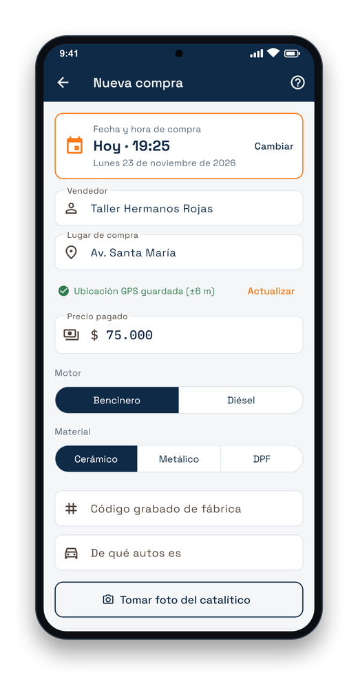
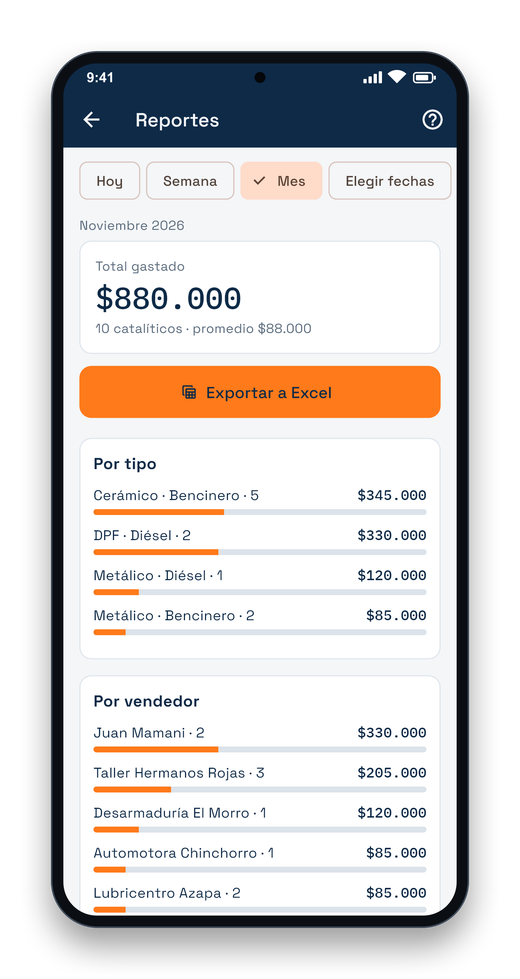
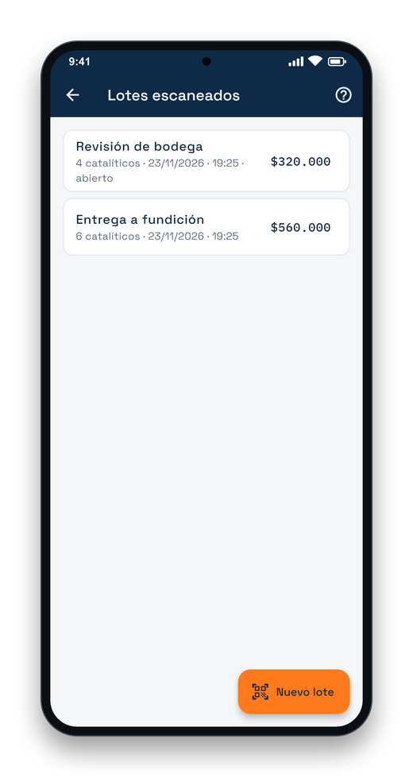
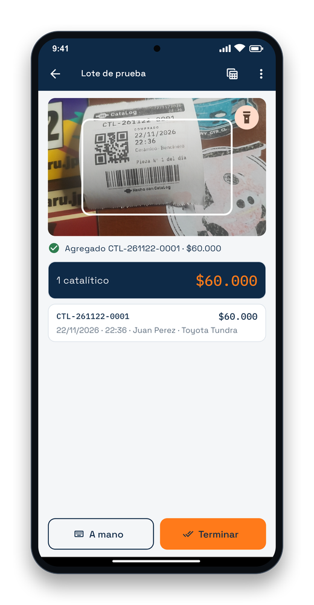
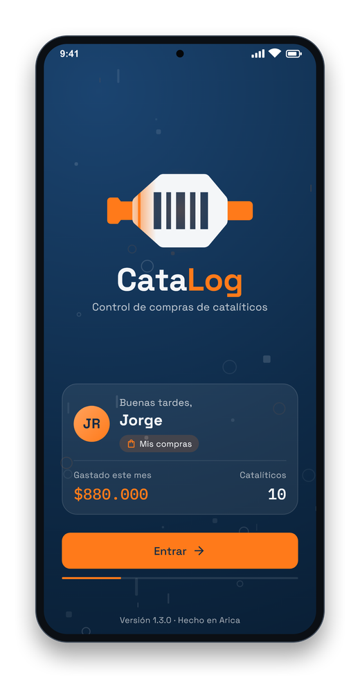
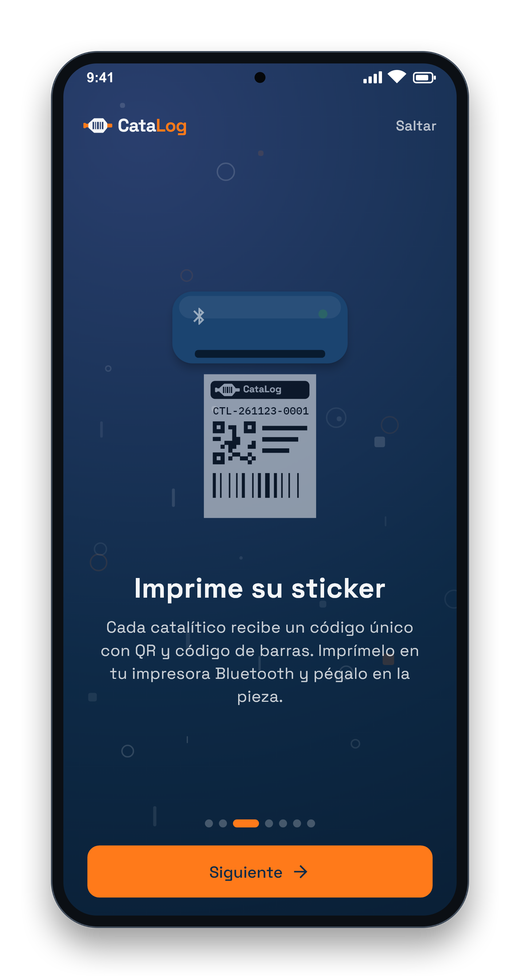
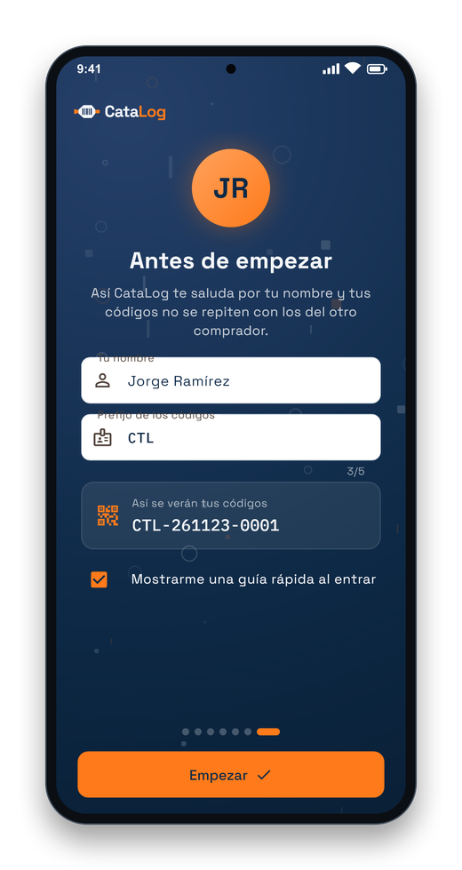
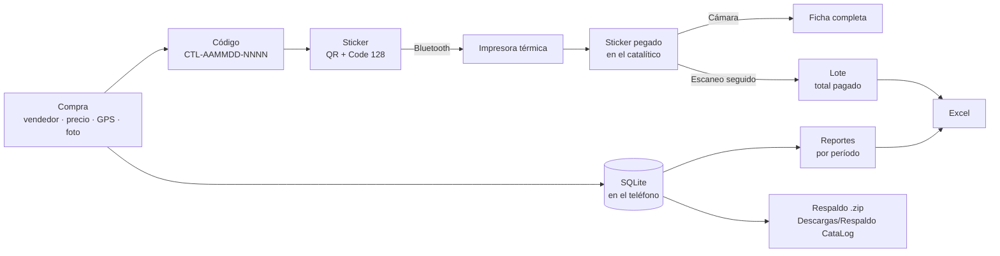
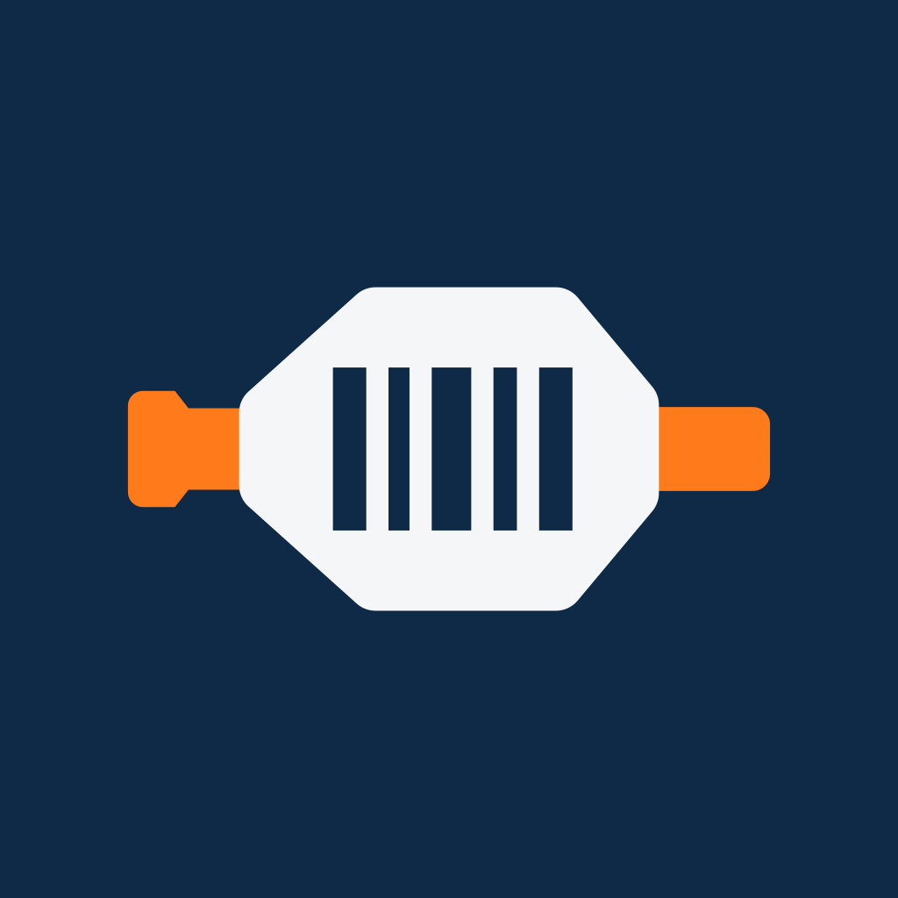

<p align="center">
  
</p>

<p align="center">
  
  
  
  
  
  
  
</p>

**CataLog** es una app para Android que lleva el control de las compras de catalíticos de un negocio familiar en Arica, Chile. Cada compra queda registrada con su fecha, vendedor, lugar, precio y tipo. La app le imprime al catalítico un sticker con QR y código de barras, lo lee después con la cámara y arma los reportes en Excel. Funciona sin internet y los datos se guardan solo en el teléfono.

<p align="center">
  <a href="#funciones">Funciones</a> ·
  <a href="#pantallas">Pantallas</a> ·
  <a href="#el-sticker">Sticker</a> ·
  <a href="#cómo-funciona">Cómo funciona</a> ·
  <a href="#tecnologías">Tecnologías</a> ·
  <a href="#arquitectura">Arquitectura</a> ·
  <a href="#pruebas">Pruebas</a> ·
  <a href="#compilar">Compilar</a>
</p>

---

## El problema

El negocio compra catalíticos casi todos los días, pero no llevaba registro: no quedaba anotado a quién se le compró, cuándo, dónde ni cuánto se pagó. Cuando se juntaban muchas piezas no había forma de saber cuánto se había gastado ni de dónde venía cada una.

CataLog anota cada compra en el momento y le asigna un código único. Ese código va impreso en un sticker que se pega en el catalítico, y más adelante basta con escanearlo para ver toda su ficha.

## Funciones

| | |
|---|---|
| **Registro de compras** | Fecha y hora de compra, vendedor, lugar con GPS, precio en pesos chilenos, motor (bencinero o diésel), material (cerámico, metálico o DPF), código grabado de fábrica, de qué autos es y foto. |
| **La fecha es lo principal** | Se llena sola, es obligatoria, se puede corregir y nunca puede ser futura. El código usa la fecha de compra (no la del registro) y la ficha muestra si alguien la corrigió y cuándo. |
| **Código único** | `PREFIJO-AAMMDD-NNNN`, por ejemplo `CTL-261122-0002`: el prefijo del teléfono, el día de compra y el número de pieza de ese día. El número se asigna dentro de una transacción y no se repite. |
| **Sticker térmico** | QR y Code 128 impresos por Bluetooth en papel de 58 u 80 mm. La app detecta sola el tipo de impresora. El precio **no** va impreso. |
| **Escáner** | La cámara lee el QR o el código de barras y abre la ficha. Funciona sin señal, y si el sticker está dañado se puede escribir el código a mano. |
| **Lotes** | Se escanean muchos stickers seguidos: la app suma lo pagado, no cuenta dos veces la misma pieza y exporta el Excel del lote. Pide un nombre al crear el lote y no guarda los lotes vacíos. |
| **Reportes en Excel** | Hoy, semana, mes, un rango de fechas o todo. Muestra el total gastado, la cantidad, el promedio y los totales por tipo, por vendedor y por mes. Exporta un Excel con resumen, tablas con colores, totales y enlaces al mapa. |
| **Nada se borra** | Las compras se anulan: salen de los totales, pero quedan en el historial y su número no se vuelve a usar. |
| **Respaldo y traspaso** | Respaldos `.zip` en `Descargas/Respaldo CataLog` (manuales y uno automático al día). Se restauran desde la misma app, y las compras se pueden mandar a otro celular por WhatsApp. |
| **Sesiones** | Las compras propias van en la *sesión de compra* y los datos recibidos de otro teléfono en una *sesión de revisión*, de solo lectura, que no se mezcla con las compras propias. |
| **Seguridad** | Bloqueo opcional con huella o PIN. Además pide la huella antes de anular, borrar o reemplazar datos. |
| **Bienvenida animada** | Al abrir, el logo se arma solo (cuerpo, tubos y barras que se abren, con una línea de escaneo). Te saluda por tu nombre y muestra lo gastado en el mes con un contador. Con el bloqueo activo, ahí mismo se entra con la huella. |
| **Presentación** | La primera vez muestra un carrusel de seis páginas con ilustraciones animadas, paralaje y un fondo que cambia de tono. La última página pide el nombre y el prefijo, con vista previa del código. |
| **Guía interactiva** | El botón de ayuda (el círculo con el signo de pregunta) de cada pantalla oscurece todo, ilumina un botón a la vez con un pulso naranja y explica para qué sirve. |
| **Responsiva** | Se adapta a teléfonos chicos, letra grande, tablets y el teléfono de lado. |

## Pantallas

<table>
  <tr>
    <td align="center" width="25%"><br><sub><b>Inicio</b><br>Gastado del mes y últimas compras</sub></td>
    <td align="center" width="25%"><br><sub><b>Nueva compra</b><br>Fecha automática y GPS</sub></td>
    <td align="center" width="25%"><br><sub><b>Ficha</b><br>Fecha de compra y sticker</sub></td>
    <td align="center" width="25%"><br><sub><b>Historial</b><br>Búsqueda y filtros por fecha y tipo</sub></td>
  </tr>
  <tr>
    <td align="center"><br><sub><b>Reportes</b><br>Por tipo y por vendedor, con Excel</sub></td>
    <td align="center"><br><sub><b>Lotes</b><br>Total pagado por grupo de piezas</sub></td>
    <td align="center"><br><sub><b>Respaldo y traspaso</b><br>Accesos directos</sub></td>
    <td align="center"><br><sub><b>En el celular real</b><br>El lote lee un sticker recién impreso</sub></td>
  </tr>
</table>

<sub>Las capturas usan datos de ejemplo (vendedores y autos inventados) y se generan con la propia app en <code>catalog_app/test/capturas_test.dart</code>. La última es una captura real de un Xiaomi 11T Pro.</sub>

### Bienvenida, presentación y guía

<table>
  <tr>
    <td align="center" width="25%"><br><sub><b>Bienvenida</b><br>Logo que se arma y saludo</sub></td>
    <td align="center" width="25%"><br><sub><b>Presentación</b><br>Ilustraciones animadas</sub></td>
    <td align="center" width="25%"><br><sub><b>Antes de empezar</b><br>Nombre, prefijo y vista del código</sub></td>
    <td align="center" width="25%"><br><sub><b>Guía</b><br>Botón de ayuda en cada pantalla</sub></td>
  </tr>
</table>

## El sticker


El sticker se dibuja con `dart:ui` al ancho exacto de la impresora (384 puntos para 58 mm y 576 para 80 mm). Después se pasa a blanco y negro y se envía como imagen ESC/POS (`GS v 0`). Así lo impreso sale igual a la vista previa, con las fuentes de la marca y los acentos, en cualquier impresora térmica.

- **QR** con el código con guiones: `CTL-261122-0002`.
- **Code 128** sin guiones: `CTL2611220002`. El codificador está escrito a mano y probado con un lector externo (zbar).
- La fecha y hora de compra, el tipo y el número de pieza del día.
- **El precio no se imprime:** solo lo ve quien escanea el sticker con CataLog en el teléfono que hizo la compra.

**Impresoras compatibles:** ESC/POS por Bluetooth clásico (SPP), ESC/POS por Bluetooth LE y las mini impresoras de AliExpress con el protocolo de tipo "gato" (servicio `AE30`, paquetes `0x51 0x78`, CRC-8). Si ninguna conecta, el sticker se comparte como imagen.

<br clear="right">

## Cómo funciona



## Tecnologías

| Área | Tecnología | Uso |
|---|---|---|
| App | **Flutter 3.50 · Dart 3.14** | Android (API 24+, target 36). Interfaz con `material_ui` (Material 3). |
| Datos | **SQLite** (`sqflite`) | Base local con migraciones; `sqflite_common_ffi` en las pruebas. |
| Sticker | `dart:ui` · `qr` · Code 128 propio | Dibujo del sticker, QR y código de barras sin servicios externos. |
| Impresión | `print_bluetooth_thermal` · `universal_ble` | ESC/POS por SPP y por BLE, más el protocolo de tipo "gato", con comandos armados en `lib/printing/`. |
| Escáner | `mobile_scanner` (ML Kit incluido) | Lectura de QR y Code 128 sin internet. |
| Ubicación y fotos | `geolocator` · `image_picker` · `url_launcher` | GPS sin conexión, foto comprimida y "Ver dónde se compró" en el mapa. |
| Reportes | `excel_plus` · `share_plus` | Excel con estilos, totales, fórmulas `HYPERLINK` y paneles fijos. Se comparte por WhatsApp o correo. |
| Respaldo | `archive` · `file_picker` · Kotlin (MediaStore) | `.zip` con la base y las fotos, guardado en Descargas y abierto con "Abrir con CataLog". |
| Seguridad | `local_auth` | Huella, rostro o PIN del teléfono. |
| Marca | Space Grotesk · IBM Plex Mono · `path_drawing` | Fuentes incluidas en la app; el logo se dibuja desde sus trazados SVG. |
| Animaciones | `CustomPainter` · `AnimationController` | La bienvenida, las ilustraciones de la presentación y el foco de la guía se dibujan a mano, sin paquetes extra. |

## Arquitectura

La app es chica y no usa frameworks de estado: un `InheritedWidget` (`AppScope`) entrega la base, los repositorios y la sesión activa, y un widget `Consulta` vuelve a leer la base cada vez que cambia algo.

```
catalog_app/lib/
├── main.dart            raíz: sesiones, bloqueo, respaldo diario, archivos recibidos
├── app_scope.dart       acceso a base, repositorios y sesión desde cualquier pantalla
├── data/                SQLite, migraciones, compras, lotes, sesiones, GPS, fotos
├── domain/              código PREFIJO-AAMMDD-NNNN, formato CLP, períodos, tipos
├── features/            una pantalla por archivo (bienvenida, presentación, inicio, compra, ficha…)
├── printing/            sticker, Code 128, ESC/POS, raster 1 bit, protocolo "gato", Bluetooth
├── reports/             cálculos de reportes y exportación a Excel
├── backup/              respaldo .zip y copia automática diaria
├── system/              huella/PIN, canal nativo con Android (MediaStore, archivos)
└── widgets/             logo, animaciones, guía con botón de ayuda, escáner, autocompletar
```

### Datos y privacidad

- Todo queda en el teléfono: no hay servidor, cuentas ni nube.
- La app **no tiene permiso de internet**: el `AndroidManifest` lo quita a propósito.
- Cada teléfono tiene su propio prefijo (`CTL`, `CTT`…), así los códigos no chocan si algún día se juntan los datos.
- Quien escanee un sticker con otra app solo ve el código, nada más.

## Pruebas

**74 pruebas automáticas** (`flutter test`). Cubren:

- La fecha de compra: obligatoria, no futura, se usa en el código y queda registro de sus correcciones.
- El generador de códigos: no repite números y reinicia el contador cada día.
- Formato de pesos chilenos y bordes de los períodos (hoy, semana, mes, rango).
- El Code 128, los comandos ESC/POS y el protocolo de las impresoras de tipo "gato" (CRC comparado con paquetes reales).
- El sticker: se dibuja a 58 y 80 mm y su QR y código de barras se pueden leer.
- El Excel: se vuelve a abrir y los totales cuadran.
- El respaldo: después de borrar y restaurar, los datos quedan iguales.
- Las sesiones de revisión.
- Pantallas sin desbordes en un teléfono chico con letra grande, en un teléfono normal y en una tablet.
- La bienvenida: saludo, contador del mes y entrada sola. La presentación: recorre las seis páginas y guarda el nombre y el prefijo; con "Saltar" no cambia nada.
- La guía: avanza y retrocede, salta los pasos que no existen, baja hasta los de abajo y se cierra en cualquier paso.
- La versión que muestra la app coincide con la del `pubspec.yaml`.

```bash
cd catalog_app
flutter analyze
flutter test
# Capturas del README (datos de ejemplo), quedan en build/capturas/
flutter test test/capturas_test.dart --dart-define=CAPTURAS=true
```

La app también se probó en un **Xiaomi 11T Pro** con una impresora térmica JST-BL1D (ESC/POS por Bluetooth clásico). Se probaron el registro, la impresión, el escaneo del sticker impreso, los lotes, la huella y la restauración de un respaldo.

## Compilar

Requisitos: Flutter 3.50, JDK 21 y Android SDK (plataforma 37, build-tools 36.1, NDK 28.2).

```bash
cd catalog_app
flutter pub get
flutter build apk --release   # necesita la llave de firma
flutter build apk --debug     # para probar sin la llave
```

La llave de firma (`llaves/`, `key.properties`) y los APK compilados (`apk/`) **no están en el repositorio**. Todas las versiones se firman con la misma llave, así que una versión nueva se instala encima de la anterior sin borrar las compras.

## Versiones

| Versión | Fecha | Cambios principales |
|---|---|---|
| **1.3** | 23-11-2026 | Bienvenida animada (con huella si hay bloqueo), presentación en carrusel, guía interactiva con botón de ayuda en cada pantalla y arranque nativo en azul marino. |
| 1.2.1 | 23-11-2026 | Probada en el celular real. Arreglo del aviso al quitar un catalítico de un lote. |
| 1.2 | 23-11-2026 | Logo refinado, sticker nuevo con "Hecho con CataLog", Excel rediseñado, carpeta `Respaldo CataLog` con restauración desde la app, nombre al crear lotes, huella para borrar, diseño responsivo. |
| 1.1 | 22-11-2026 | Sesiones de compra y revisión, envío a otro celular, respaldo diario, bloqueo con huella o PIN. |
| 1.0 | 22-11-2026 | Registro, sticker, impresión Bluetooth, escáner, lotes, reportes en Excel y respaldo. |

## Marca

<picture>
  <source media="(prefers-color-scheme: dark)" srcset="marca/catalog-logo-oscuro.svg">
  
</picture>

| Color | Hex | Uso |
|---|---|---|
|  Azul marino | `#0E2A47` | Fondo de la marca, barras y textos |
|  Naranja escape | `#FF7A1A` | Acciones principales y tubos del logo |
|  Gris niebla | `#F4F6F8` | Fondos claros |
|  Acero | `#5B6B7C` | Textos secundarios |

Fuentes: **Space Grotesk** (textos) e **IBM Plex Mono** (códigos y montos). Los logos, íconos y propuestas anteriores están en [`marca/`](marca/).

## Documentación

- [Guía de uso](GUIA-DE-USO.md), para quien usa la app.
- [Logos, íconos y propuestas de la marca](marca/), con las versiones descartadas.

---

<p align="center">
  <br>
  <sub>Hecha para un negocio familiar de Arica, Chile · Proyecto privado</sub>
</p>
