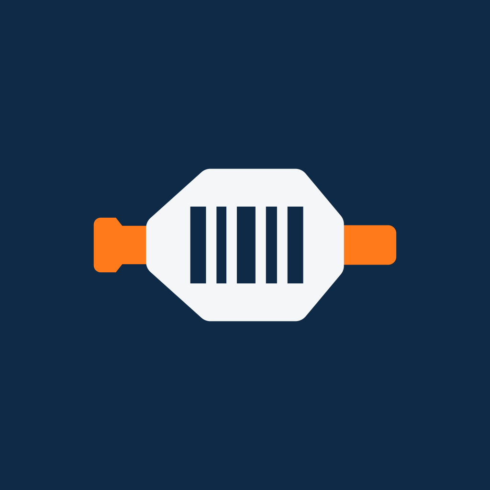

# CataLog

Una app para Android que registra cada catalítico que compra un negocio familiar. Le imprime un sticker con código y arma los reportes en Excel. Funciona sin internet y guarda todo en el teléfono.

<p align="center"></p>

## Para qué se hizo

El negocio compra catalíticos casi todos los días y no llevaba registro: no quedaba anotado cuánto se pagó, a quién ni cuándo. CataLog guarda cada compra en el momento, le pone un código único que va pegado al catalítico y permite revisar después cualquier pieza escaneando su sticker.

## Qué hace

- **Registrar una compra.** Guarda la fecha y hora de compra (el dato más importante: se llena sola, se puede corregir y nunca puede ser futura), el vendedor, el lugar con GPS, el precio en pesos chilenos, el motor (bencinero o diésel), el material (cerámico, metálico o DPF), si es original, el código grabado de fábrica, de qué autos es y una foto.
- **Código único.** Cada catalítico recibe un código `PREFIJO-AAMMDD-NNNN`, por ejemplo `CTL-261122-0007`: el prefijo del teléfono, la fecha de compra y el número del día.
- **Sticker.** Imprime en una impresora térmica Bluetooth un sticker con QR (con guiones) y Code 128 (sin guiones). Detecta sola el tipo de impresora: ESC/POS clásica (SPP), ESC/POS por Bluetooth LE o las impresoras tipo "gato" de AliExpress. Si ninguna conecta, comparte el sticker como imagen. **El precio no va impreso.**
- **Escanear.** Al leer el QR o el código de barras se abre la ficha completa. Si el sticker está dañado, el código se puede escribir a mano.
- **Lotes.** Se escanean varios stickers seguidos: la app suma lo pagado, no cuenta dos veces el mismo y exporta el Excel del lote.
- **Reportes.** Total gastado, cantidad y promedio por día, semana, mes, unas fechas o todo, con totales por tipo y por vendedor. Exporta a Excel con las hojas Resumen, Compras, Por tipo y Por vendedor.
- **Nada se borra.** Una compra se anula, pero queda en el historial y su número no se vuelve a usar. Si se corrige la fecha de compra, la ficha muestra que se corrigió y cuándo.
- **Respaldo y traspaso.** Respaldo en `.zip` para mandar por correo o a la nube, copia automática diaria en `Descargas/CataLog`, restauración en un teléfono nuevo y envío de las compras a otro celular para revisarlas sin mezclarlas.
- **Bloqueo** con huella o con el PIN del teléfono.

La guía para quien la usa está en [GUIA-DE-USO.md](GUIA-DE-USO.md).

## Cómo está hecha

- Flutter (Android), con SQLite (`sqflite`) para los datos.
- Sticker dibujado con `dart:ui` a 384 o 576 puntos (papel de 58 u 80 mm). El Code 128 está escrito sin dependencias, en `lib/printing/code128.dart`.
- Impresión: `print_bluetooth_thermal` para SPP y `universal_ble` para BLE y el protocolo "gato", en `lib/printing/`.
- Escáner: `mobile_scanner`. Excel: `excel_plus`. Respaldo: `archive`.
- Marca: azul marino `#0E2A47`, naranja `#FF7A1A`, Space Grotesk e IBM Plex Mono (en `marca/`).

```
catalog_app/   la app en Flutter (lib/, test/, android/)
marca/         logos, íconos y fuentes de CataLog
GUIA-DE-USO.md guía para quien usa la app
```

## Compilar

```bash
cd catalog_app
flutter pub get
flutter test
flutter build apk --release
```

La llave de firma (`llaves/`, `key.properties`) y los APK compilados (`apk/`) **no están en el repositorio**. Sin la llave, `flutter build apk --debug` funciona igual para probar.
